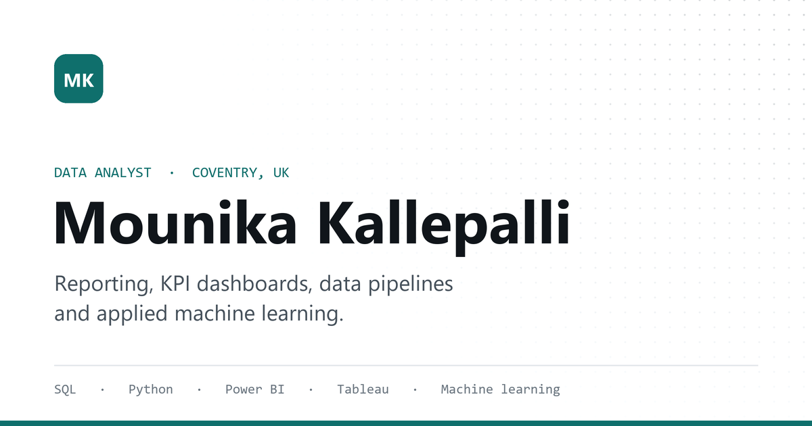

# Mounika Kallepalli — Data Analyst Portfolio

Personal portfolio for **Mounika Kallepalli**, a data analyst based in Coventry, UK, working in SQL, Python and Power BI.

**Live site:** https://mounikakallepalli.netlify.app/



## Overview

A single-page, static portfolio covering experience, selected projects, technical skills, education and certifications, with a downloadable CV.

- No frameworks and no build step: plain HTML, CSS and JavaScript
- Light and dark themes, following the system preference with a manual toggle
- Responsive from 320px phones to wide desktops
- Accessible: semantic landmarks, skip link, keyboard navigation, visible focus states and `prefers-reduced-motion` support
- Search and share ready: meta description, Open Graph and Twitter cards, and `schema.org` Person data

## Structure

| File | Purpose |
| --- | --- |
| `index.html` | Page content and metadata |
| `styles.css` | Design tokens, layout and components |
| `script.js` | Theme toggle, mobile menu, scroll effects (optional; the page works without it) |
| `Mounika-Kallepalli-CV.pdf` | Downloadable CV |
| `og-image.png` | 1200 × 630 social share image |
| `favicon.svg` | Site icon |
| `404.html` | Not-found page for GitHub Pages |

## Run locally

Open `index.html` in a browser, or serve the folder:

```bash
python -m http.server 8000
```

Then visit http://localhost:8000.

## Deployment

The site is hosted on Netlify and served from the repository root, with no build command. If the Netlify site is linked to this repository, pushing to `main` publishes changes; otherwise drag the folder into the Netlify deploy page. Netlify serves `404.html` automatically for unknown paths.

If the site moves to a custom domain, update the `canonical`, `og:url`, `og:image` and `twitter:image` URLs and the JSON-LD `url` in `index.html`.

## Updating content

- **CV:** replace `Mounika-Kallepalli-CV.pdf`, keeping the same file name.
- **Project links:** each project card has an empty `.project-links` container; an example link is in the comment above the project grid in `index.html`.
- **Theme colours:** all colours are CSS custom properties at the top of `styles.css`.

---

© Mounika Kallepalli. All rights reserved.
